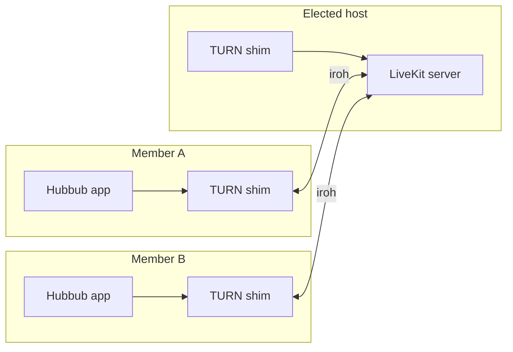

# Hubbub

**Open-source voice, text and screen-share chat that runs on your friends' computers instead of a company's servers.**

<p align="center">
  
</p>

<p align="center">
  <a href="LICENSE"></a>
  
  
</p>

## Why

Chat servers are usually someone else's machine, behind someone else's account system. Hubbub removes both. A server is a group of friends who each run the app; one of them acts as the host at any moment, and the role moves when that person leaves. You join with a link. There are no accounts, no central service, no port forwarding and no router settings.

The interface is deliberately familiar: servers, text and voice channels, a member list, screen sharing. If you have used a community chat app before, you already know how to use this one.

> **Status: pre-release.** Version 0.1.0, unsigned, being tested with a small group of friends. Expect rough edges. See [Status](#status-and-roadmap).

## Features

- **Voice, text and screen share** in channels, with voice-channel presence visible to everyone in the server.
- **No server to rent.** The member elected as host runs a bundled [LiveKit](https://livekit.io) media server; the role rotates and hands over when the host leaves, and calls follow it.
- **No port forwarding.** Call media travels over [iroh](https://www.iroh.computer) connections, not open ports.
- **End-to-end encrypted calls.** The call key is derived from the community's key material.
- **Text ordered by the host**, with catch-up for members who were offline.
- **Invite links** (`hubbub://join/...`) that work with no central service: any online member can admit you. Hubbub detects an invite on your clipboard. You can be in several servers at once.
- **Audio controls:** RNNoise noise suppression, input volume and a live peak meter.
- **Desktop integration:** Windows installer with a tray icon and start at login; Linux AppImage.

## Install

Download the latest build from the project's GitHub releases page. Full instructions, including the unsigned-installer warning, microphone permission and Linux dependencies, are in [docs/INSTALL.md](docs/INSTALL.md).

- **Windows:** run `HubbubSetup.exe`. It installs for your account only and needs no admin password. Because it is not signed yet, Windows shows "Windows protected your PC": choose **More info**, then **Run anyway**.
- **Linux:** download `HubbubLinux.AppImage`, `chmod +x` it and run it. It needs FUSE and the AppIndicator library for the tray icon.

## How it works



1. **Identity and membership.** Each install has its own keypair. A server (a "community") is a shared membership list and key material replicated between members over [iroh](https://www.iroh.computer) connections. There is no account database.
2. **Joining.** An invite is a `hubbub://join/...` link. Any member who is online checks it against their own copy of the server state, admits you, and broadcasts the new member list.
3. **Host election.** Members elect one host. The host orders text messages, assembles voice presence, and runs a bundled LiveKit server on loopback. When the host leaves, another member takes over and ongoing calls move with it.
4. **Media without open ports.** LiveKit listens only on the host's loopback address. Every member, including the host, runs a small local TURN server (the "shim") that gives their WebRTC client a relay address. Each packet is carried as a frame over the iroh tunnel to the host's LiveKit, so nothing needs to be reachable from the internet.
5. **Encryption.** Call media is end-to-end encrypted with a key taken from the community, so the host's LiveKit server forwards packets it cannot read.
6. **Text.** The host assigns an order to messages. A member who comes online later asks peers for what it missed.

The design documents are in [docs/superpowers/specs](docs/superpowers/specs) (the original design and the invites design), and prior-art notes are in [docs/research](docs/research).

## Philosophy

Community chat shouldn't depend on one company's servers, business model or terms of service. Hubbub is the open alternative: the same familiar experience, owned by the people who use it.

- **Open source.** All of Hubbub is MIT licensed and developed in the open. Anyone can read the code, audit it, run it, fork it or improve it.
- **Free forever.** Everything you need to talk with your friends (servers, text, voice, video, screen sharing, invites) is free, with no limits and no expiry. Optional premium features may come later to fund development. They will be extras on top, and nothing that is free today will move behind a paywall.
- **Community driven.** The roadmap is shaped by the people who use it. Issues, ideas and pull requests are welcome, and the project is meant to outlive any one maintainer.
- **Your data stays yours.** There is no Hubbub cloud. Messages and server data live on the members' own computers and travel between them over encrypted peer-to-peer links. When no direct path exists, a relay passes along traffic it cannot read. There are no accounts, no ads, no tracking, no analytics, and nothing to sell.
- **Secure by design.** Every connection between members is encrypted, and voice and video calls are end-to-end encrypted. A server's keys are held by its members and shared only through its invite links. Because the code is open, none of this has to be taken on trust.
- **It just works.** No router settings, no sign-up, no setup steps. Install it, share an invite link, and talk.

## Status and roadmap

Version 0.1.0, pre-release and unsigned.

**The goal right now is a solid foundation.** Joining, calls, text, screen sharing and host handover have to work well and consistently on every platform before anything else is added. After that, new features come from what the community asks for and helps build.

1. **Foundation (now):** reliability across networks and machines, the macOS build, Linux screen sharing on Wayland, signed installers and automatic updates.
2. **Community features (next):** whatever users ask for most. Open an issue to suggest something or to vote on an existing idea.

| Platform | State |
| --- | --- |
| Windows | Primary platform. Velopack installer, tray icon, start at login. |
| Linux | AppImage. Updates are manual. Screen sharing is off on Wayland for now; a Linux screen share carries video only. |
| macOS | In progress. No installer yet. |

- **Auto-update:** the Windows updater is built in, but the update feed is not published yet (the feed URL in `app/lib/install.dart` is a placeholder), so updates are manual for now.
- **Signing:** installers are not code-signed.
- **Mobile:** not supported.

## Build from source

You need:

- Flutter (stable channel; the app requires Dart 3.13.5 or newer, and has been built with Flutter 3.47.7), with desktop support for your platform.
- Rust (stable, via `rustup`; `rust-toolchain.toml` selects the channel).
- Bash and `curl` to run the LiveKit download script (use WSL or Git Bash on Windows; check out with LF line endings or the script will fail).
- For installers: the [Velopack](https://velopack.io) `vpk` tool (`dotnet tool install -g vpk`).

```sh
# 1. Fetch the bundled LiveKit server (version pinned in tools/livekit-version.txt)
tools/fetch-livekit.sh windows amd64     # or: linux amd64

# 2. Build the app (this also builds the Rust core)
cd app
flutter pub get
flutter build windows --release          # or: flutter build linux --release

# 3. Run the Rust tests
cd ..
cargo test -p hubbub-core --features test-util
```

Packaging (details in [docs/RELEASING.md](docs/RELEASING.md)):

```sh
powershell -File tools\package-windows.ps1     # Windows installer and update feed, into dist\windows
tools/package-linux.sh                         # Linux AppImage, into dist/linux
```

The first Windows or Linux build downloads a prebuilt libwebrtc, so it needs network access. The Dart bindings to the Rust core are generated with `flutter_rust_bridge_codegen generate` in `app/`.

## Project layout

| Path | What it is |
| --- | --- |
| `app/` | Flutter UI (`app/lib`), tests, and the platform runners. |
| `app/rust/` | The flutter_rust_bridge crate that exposes the core to Dart. |
| `core/` | `hubbub-core`, the Rust library: iroh networking, membership and invites, host election, text, voice presence, LiveKit hosting and the media tunnel and TURN shim. |
| `cli/` | Command-line front end to the core. |
| `third_party/flutter_webrtc/` | Fork of `flutter_webrtc` with the audio processing patches (RNNoise, input volume, peak meter). See `HUBBUB_PATCHES.md` there. |
| `tools/` | LiveKit fetch script, packaging scripts, smoke tests and the relay check. |
| `vendor/` | Downloaded LiveKit binaries (not committed). |
| `docs/` | Install and release guides, design specs, research and brand assets. |

## Contributing

Hubbub is meant to be built together, and help of every kind is welcome:

- **Test it.** Use it with friends on different networks and machines, and report what breaks, with logs if you can. This is the most valuable help while the foundation is being finished.
- **Report bugs and suggest features** in [Issues](https://github.com/sbenson2/hubbub/issues).
- **Send code.** Pull requests are welcome. Open an issue first for anything large, so we can agree on the approach.
- **Improve the docs**, translations and the first-run experience.

See [CONTRIBUTING.md](CONTRIBUTING.md) for how to build, test and send a change.

## License

[MIT](LICENSE). Bundled components keep their own licences: LiveKit server (Apache-2.0), `flutter_webrtc` (MIT, see `third_party/flutter_webrtc/LICENSE`), and the other dependencies listed in `Cargo.lock` and `app/pubspec.lock`.
