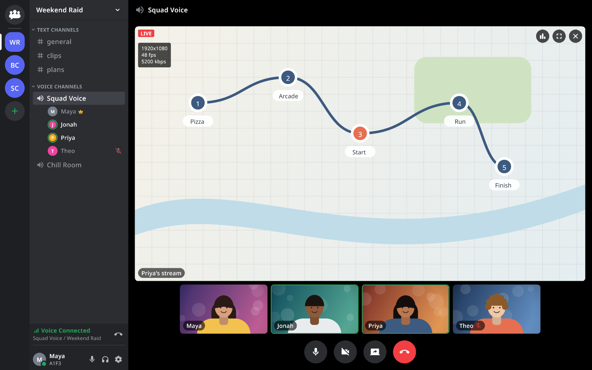
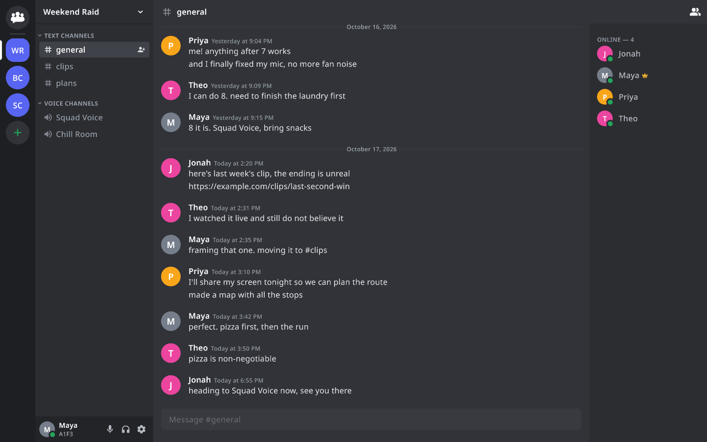
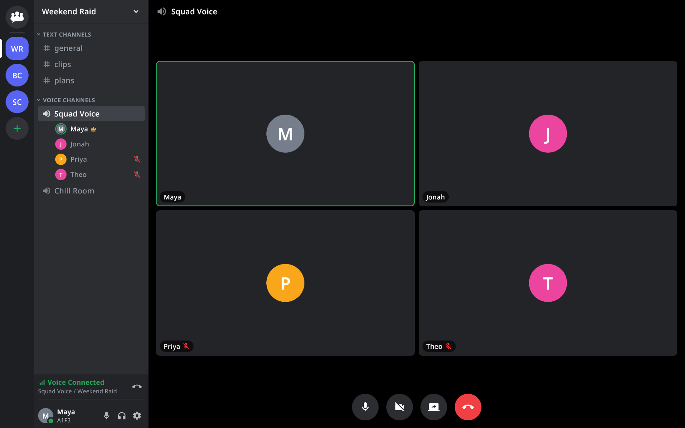
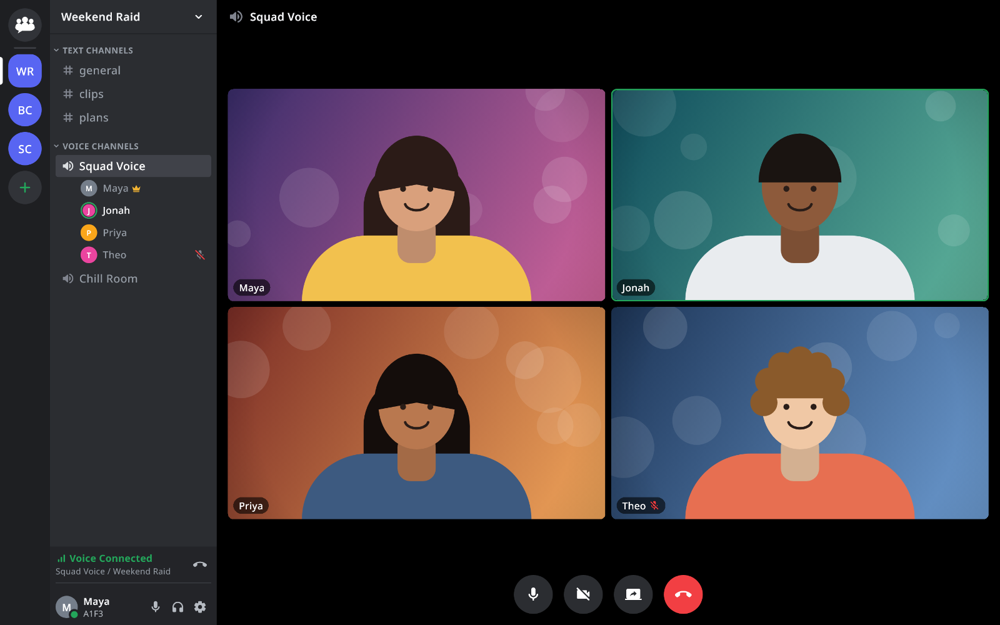
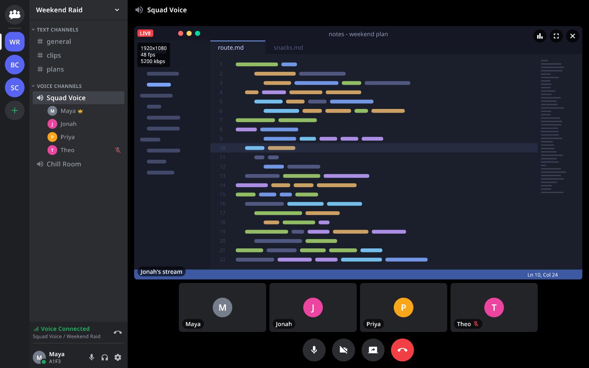
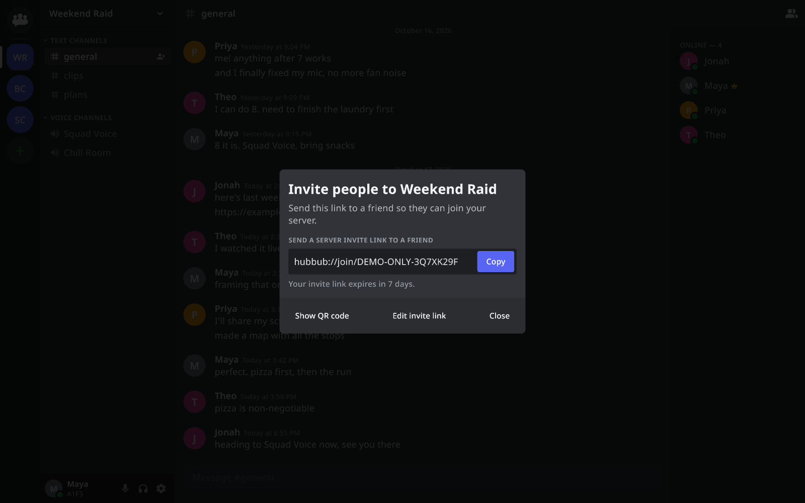
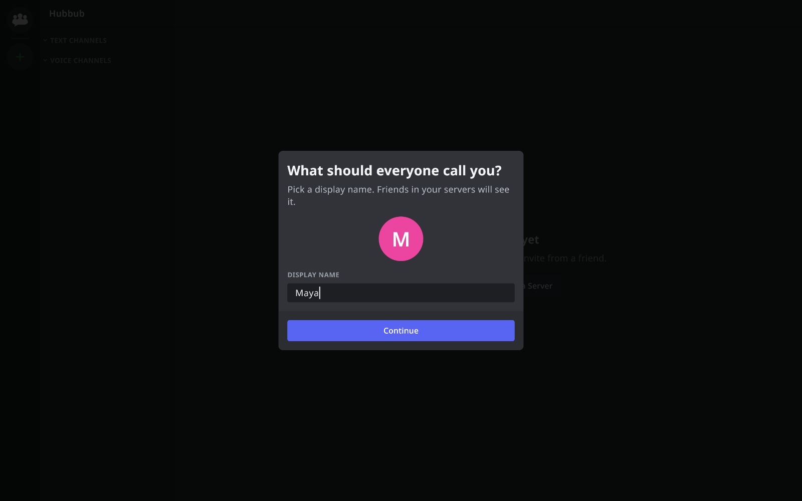
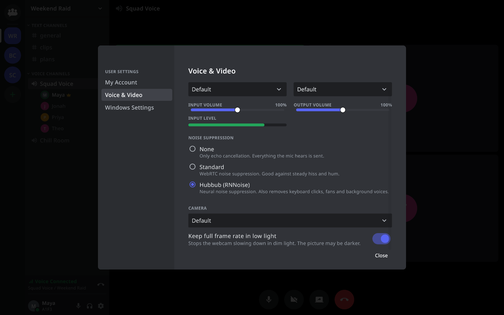
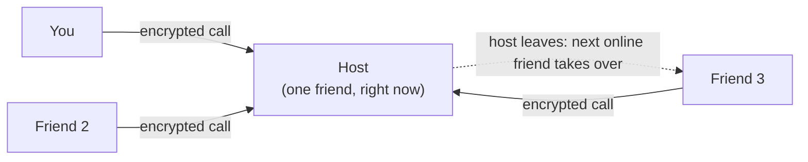

<p align="center">
  
</p>

<h1 align="center">Hubbub</h1>

<p align="center"><b>Voice, video and screen share with your friends. No servers, no accounts, no bill.</b></p>

<p align="center">
  <a href="LICENSE"></a>
  <a href="https://github.com/sbenson2/hubbub/releases/latest"></a>
  
</p>

<p align="center">
  <a href="https://github.com/sbenson2/hubbub/releases/latest/download/HubbubSetup.exe"><b>Download for Windows</b></a>
  &nbsp;|&nbsp;
  <a href="https://github.com/sbenson2/hubbub/releases/latest/download/HubbubMac.pkg"><b>Download for macOS</b></a>
  &nbsp;|&nbsp;
  <a href="https://github.com/sbenson2/hubbub/releases/latest/download/HubbubLinux.AppImage"><b>Download for Linux</b></a>
</p>

<p align="center"><sub>Free and open source (MIT). Early software, being tested with friends. <a href="#install">Install notes</a></sub></p>

<p align="center">
  
</p>

## Why Hubbub

- **No server to rent.** Your friends' computers are the network. One of them hosts at any moment, and you never set anything up.
- **No account.** Install it, type a name, paste an invite link.
- **Free 1080p screen share.** 1080p, with no paywall and no time limit.
- **End-to-end encrypted calls.** The computer that hosts a call can't listen in on it.
- **Your friends are the network.** If the host closes the app, another online friend takes over.
- **Open source.** MIT licensed. Read the code, run it, fork it.

## Features

### Text channels and chat

A familiar Discord-style layout: servers on the left, channels next to them, members on the right. Chat in text channels, and catch up on what you missed when you come back online.

<p align="center"></p>

### Voice with noise suppression

Jump into a voice channel and see who is in it before you join. Built-in RNNoise noise suppression cuts keyboard clatter and fan noise. There is an input volume control and a live level meter.

<p align="center"></p>

### Video grid

Turn on your webcam (720p at 30 fps) and everyone shows up in one grid. On Windows, a "Keep full frame rate in low light" setting keeps the camera at 30 fps in a dim room.

<p align="center"></p>

### Screen share

Share your screen at 1080p, at 30+ fps. On 4K monitors the share is scaled to 1080p and currently measures about 35 fps. Stream Stats show what your camera and your own share are actually sending.

<p align="center"></p>

### Invites that are just a link

Make an invite and send it to a friend. It looks like `hubbub://join/...`. They paste it into Hubbub, or Hubbub notices it on their clipboard. Anyone holding a valid link can join, so share it with people you trust. You can be in several servers at once.

<p align="center"></p>

### Quick to start

The first launch asks for a name and not much else.

<p align="center"></p>

### Settings, and a tray icon

Pick your mic and camera, tune noise suppression, and choose whether Hubbub starts with Windows. It lives in the tray, so your servers stay online when you close the window.

<p align="center"></p>

## How it works



- Each server is a group of friends who all run Hubbub. There is no company in the middle.
- One online friend acts as the host. Their copy of Hubbub runs the call and puts chat in order.
- If the host goes offline, the role moves to someone who is online, and calls follow.
- Call audio and video are end-to-end encrypted. The host forwards them but can't read them.
- Nobody needs to open ports or change router settings.

Under the hood: [iroh](https://www.iroh.computer) connections between peers, and a bundled [LiveKit](https://livekit.io) media server on the host. The full design is in [docs/superpowers/specs](docs/superpowers/specs).

## Install

Pick your platform and download. Full notes are in [docs/INSTALL.md](docs/INSTALL.md).

| Platform | Download | Notes |
| --- | --- | --- |
| Windows | [HubbubSetup.exe](https://github.com/sbenson2/hubbub/releases/latest/download/HubbubSetup.exe) | Installs for your account, no admin password. Updates itself. |
| macOS (Apple silicon) | [HubbubMac.pkg](https://github.com/sbenson2/hubbub/releases/latest/download/HubbubMac.pkg) | Updates are manual for now. |
| Linux | [HubbubLinux.AppImage](https://github.com/sbenson2/hubbub/releases/latest/download/HubbubLinux.AppImage) | Updates are manual. Needs FUSE and the AppIndicator library. |

<sub>v0.1.1 is Windows-first: the macOS and Linux files follow shortly.</sub>

**Hubbub isn't code-signed yet**, so your system will warn you the first time. That's expected.

- **Windows:** SmartScreen says "Windows protected your PC". Click **More info**, then **Run anyway**.
- **macOS:** open the .pkg and, when macOS refuses, go to System Settings, Privacy & Security and click **Open Anyway**. Repeat if it blocks Hubbub itself on first start.
- **Linux:** `chmod +x HubbubLinux.AppImage`, then run it.

## FAQ

**Is it really free?**
Yes. Hubbub is MIT licensed, and everything in it is free: servers, text, voice, video and screen share. There are no ads and no tracking.

**Do I need a server?**
No. There is nothing to rent or set up. A friend's computer hosts for you, and the role moves around.

**Who can join?**
Anyone with a valid invite link. Treat the link like a key and share it with people you trust.

**What happens when the host goes offline?**
Another online member takes over as host, and calls move with it. If nobody in a server is online, there is nothing running until someone opens Hubbub.

**Is it private?**
Calls are end-to-end encrypted. There is no Hubbub cloud: messages and server data live on the members' own computers and travel directly between them. The code is open, so you can check.

**Does it work over the internet?**
Yes. Friends can be on different networks. No port forwarding or router changes are needed.

## Status

Hubbub is early software. It is being tested with a small group of friends, installers are unsigned, and there will be rough edges. Windows is the primary platform. Right now the focus is reliability: joining, calls, chat, screen share and host handover working well everywhere. Signed installers come after that, then whatever people ask for.

Found a bug? [Open an issue](https://github.com/sbenson2/hubbub/issues). Logs help.

## Build from source

You need Flutter (stable), Rust (stable, via `rustup`) and Bash with `curl`.

```sh
tools/fetch-livekit.sh windows amd64     # or: linux amd64
cd app
flutter pub get
flutter build windows --release          # or: flutter build linux --release
cd .. && cargo test -p hubbub-core --features test-util
```

Details, packaging and what to run before a pull request are in [CONTRIBUTING.md](CONTRIBUTING.md) and [docs/RELEASING.md](docs/RELEASING.md).

## Contributing

Testing with friends on different networks is the most useful help right now. Bug reports, ideas and pull requests are welcome. See [CONTRIBUTING.md](CONTRIBUTING.md).

## License

[MIT](LICENSE). Bundled components keep their own licences: LiveKit server (Apache-2.0), `flutter_webrtc` (MIT), and the dependencies listed in `Cargo.lock` and `app/pubspec.lock`.
